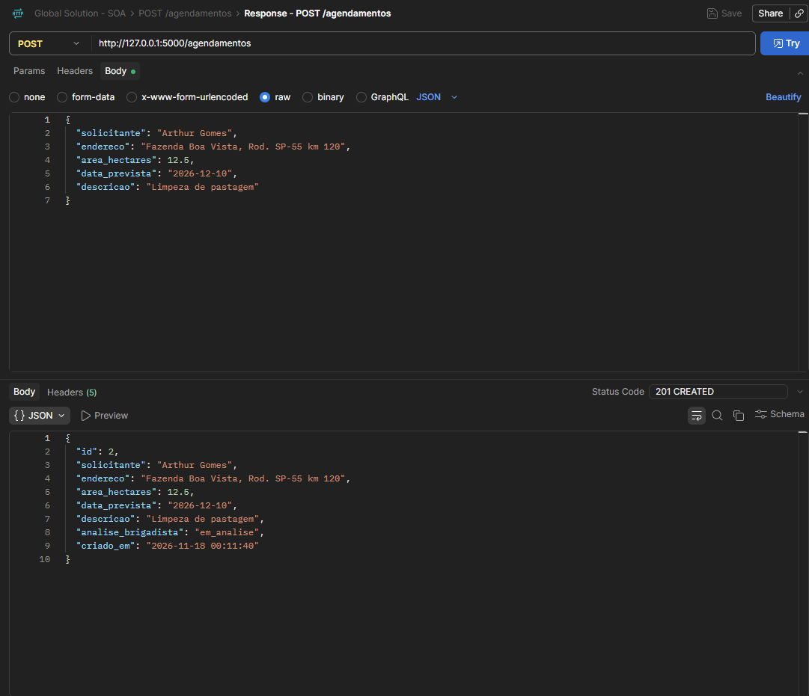
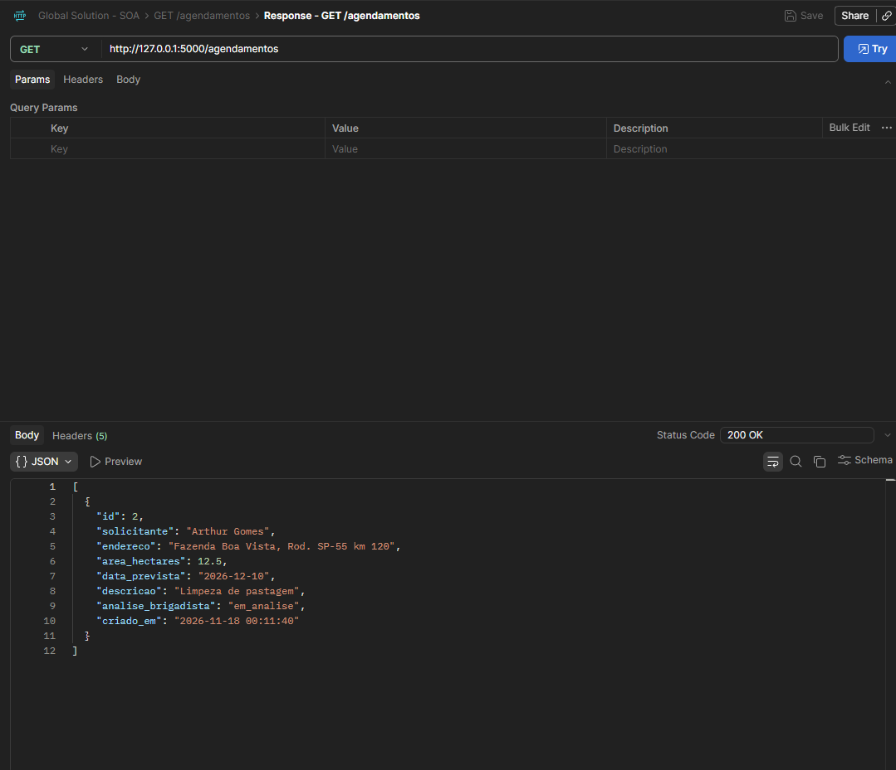
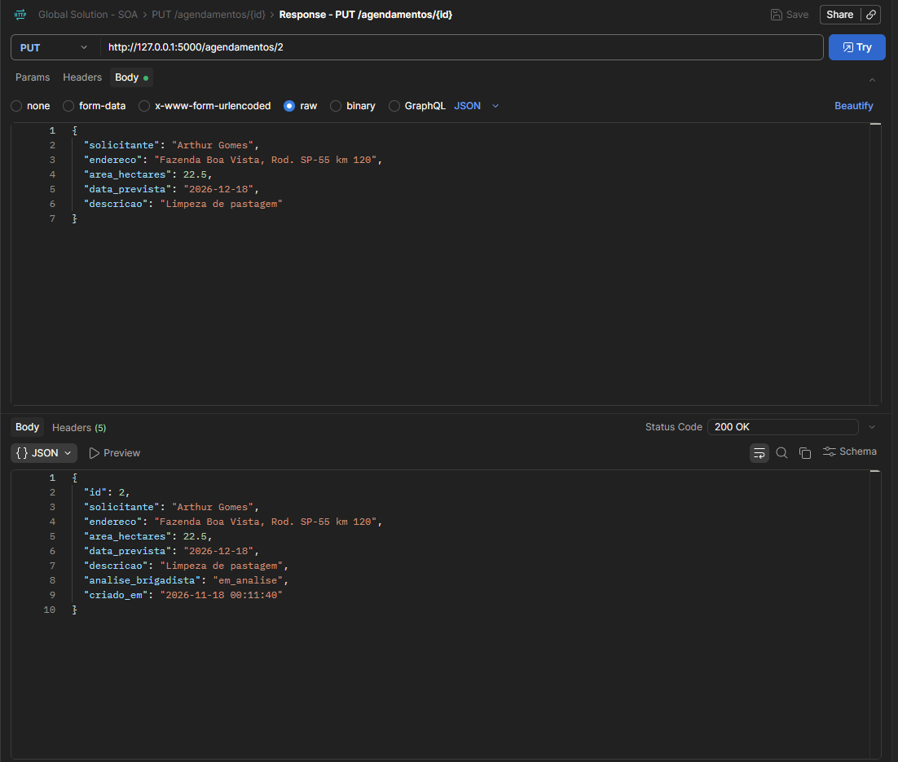
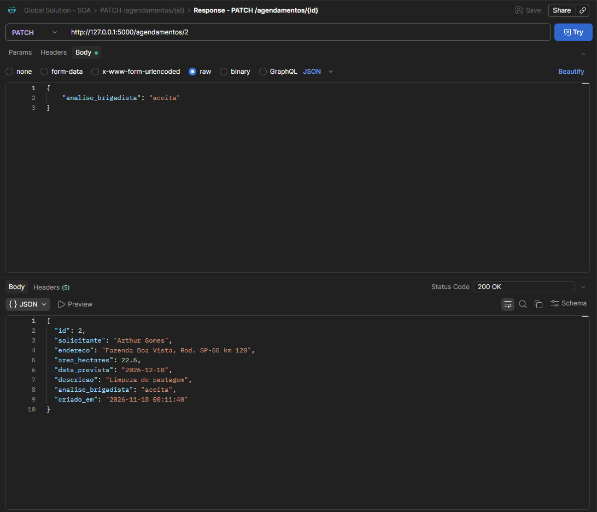
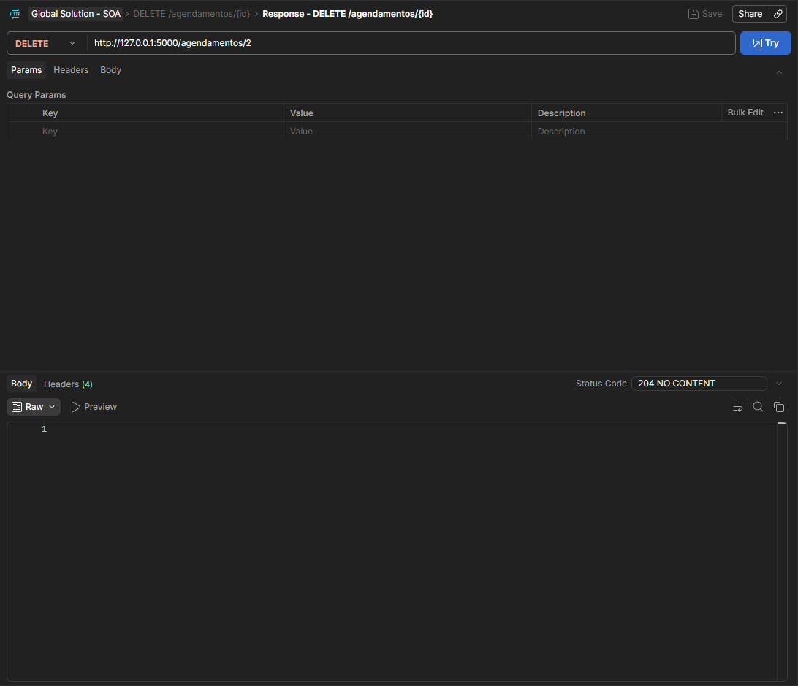

# Agendador de Queima Prescrita — API REST

> Global Solution 2026.2 · CitizenTech · FIAP — Engenharia de Software, 3º ano
> Disciplina: **Arquitetura Orientada a Serviços (SOA) e Web Services**

## Integrantes

| Nome | RM |
|---|---|
| Arthur Gomes | RM 560771 |
| Luiz Silva | RM 560110 |
| Matheus Siroma | RM 560248 |
| Pedro Estevam | RM560642 |

## Ficha da CitizenTech

| | |
|---|---|
| **Nome da CitizenTech** | Agendador de Queima Prescrita |
| **Cidade e bairro** | _Cidade / bairro ou região rural_ |
| **Cidadão beneficiado** | Produtores rurais que precisam manejar a vegetação da propriedade e brigadistas que analisam e acompanham essas queimas |
| **Problema, em uma frase** | Queimas feitas sem planejamento nem acompanhamento de brigadistas fogem do controle e viram incêndios, enquanto a brigada não tem um canal organizado para receber e avaliar os pedidos de queima prescrita |
| **Como funciona** | O produtor registra uma solicitação de queima (local, área e data prevista); a brigada analisa o pedido e o marca como aceito ou recusado; as queimas aceitas ficam visíveis para planejamento e acompanhamento |
| **O que cada parte faz** | Esta API (SOA) é o backend: recebe, valida e guarda as solicitações num banco PostgreSQL e expõe o fluxo de análise da brigada por endpoints REST |
| **Link do repositório** | _https://github.com/usuario/repositorio_ |
| **ODS conectados** | ODS 13 (Ação contra a mudança global do clima), ODS 11 (Cidades e comunidades sustentáveis), ODS 2 (Fome zero e agricultura sustentável) |

### Conexão com os ODS

- **ODS 13 — Ação contra a mudança do clima:** a queima prescrita reduz o material seco acumulado na vegetação, o que diminui o risco de grandes incêndios florestais e das emissões que eles causam.
- **ODS 11 — Cidades e comunidades sustentáveis:** organizar e acompanhar as queimas ajuda a prevenir desastres que atingem comunidades próximas a áreas de vegetação.
- **ODS 2 — Agricultura sustentável:** dá ao produtor um caminho seguro e acompanhado para manejar pastagens e áreas de cultivo.

## Descrição da solução

A queima prescrita é uma técnica de manejo em que o fogo é usado de forma planejada, em local, época e condições definidas, para reduzir o acúmulo de material inflamável e prevenir incêndios maiores. Para ser segura, ela precisa ser avaliada e acompanhada por brigadistas.

Esta API é o **backend** da nossa CitizenTech. Ela centraliza as solicitações de queima e o fluxo de análise da brigada:

1. Os brigadistas são cadastrados com nome, brigada e região de atuação.
2. O produtor envia uma solicitação com solicitante, endereço, área em hectares, data prevista e uma descrição opcional.
3. Toda solicitação nasce com o status `em_analise`, sem brigadista vinculado.
4. Um brigadista avalia o pedido e altera o status para `aceita` ou `recusada`. A API exige que ele se identifique (`brigadista_id`), então toda decisão fica registrada com um responsável.
5. Solicitações recusadas deixam de aparecer nas consultas de agendamentos (exclusão lógica), mas o registro continua no banco e no histórico do brigadista.

## Tecnologias

- Python 3 com Flask (API REST)
- PostgreSQL (banco de dados)
- psycopg 3 (conexão com o banco, com consultas parametrizadas)
- python-dotenv (configuração da conexão via `.env`)
- Migrations em SQL versionadas na pasta `migrations/`
- Postman (testes manuais da API)

## Como rodar

### Pré-requisitos

- Python 3.11 ou superior
- PostgreSQL 14 ou superior rodando

### Passo a passo

1. **Instale as dependências**

   ```bash
   py -m pip install -r requirements.txt
   ```

2. **Crie o banco** (uma única vez)

   ```bash
   psql -U postgres -c "CREATE DATABASE queimas;"
   ```

3. **Configure a conexão**: copie `.env.example` para `.env` e ajuste usuário e senha:

   ```
   DB_HOST=127.0.0.1
   DB_PORT=5432
   DB_NAME=queimas
   DB_USER=postgres
   DB_PASSWORD=sua_senha
   ```

4. **Suba a API**

   ```bash
   py app.py
   ```

   Ao iniciar, a API aplica automaticamente as migrations da pasta `migrations/`. Ela fica disponível em `http://127.0.0.1:5000`.

O passo a passo completo do banco, com as migrations, a estrutura da tabela e como criar novas migrations, está no [MIGRATION.md](MIGRATION.md).

## Estrutura do projeto

```
├── app.py               # rotas REST e validação dos dados de entrada
├── database.py          # conexão com o PostgreSQL e consultas SQL
├── migrations/          # scripts SQL versionados de criação do banco
│   ├── 001_create_agendamentos.sql
│   ├── 002_create_brigadistas.sql
│   └── 003_add_brigadista_em_agendamentos.sql
├── docs/testes/         # collection do Postman e prints dos testes
├── MIGRATION.md         # documentação das migrations
├── requirements.txt     # dependências do projeto
└── .env.example         # modelo de configuração da conexão
```

## Modelo de dados

O domínio tem duas entidades: **Brigadista** e **Agendamento**. Um brigadista pode analisar vários agendamentos, e cada agendamento analisado pertence a um brigadista (relacionamento 1:N).

```
brigadistas (1) ────< (N) agendamentos
     id  ◄──────────────── brigadista_id (FK)
```

Tabela `brigadistas`:

| Coluna | Tipo | Regras |
|---|---|---|
| `id` | `SERIAL` | Chave primária |
| `nome` | `VARCHAR(150)` | Obrigatório |
| `brigada` | `VARCHAR(150)` | Obrigatório |
| `regiao` | `VARCHAR(150)` | Obrigatório |
| `criado_em` | `TIMESTAMP` | Preenchido automaticamente |

Tabela `agendamentos`:

| Coluna | Tipo | Regras |
|---|---|---|
| `id` | `SERIAL` | Chave primária |
| `solicitante` | `VARCHAR(150)` | Obrigatório |
| `endereco` | `VARCHAR(255)` | Obrigatório |
| `area_hectares` | `DOUBLE PRECISION` | Obrigatório, maior que zero |
| `data_prevista` | `DATE` | Obrigatório |
| `descricao` | `TEXT` | Opcional |
| `analise_brigadista` | `VARCHAR(20)` | Padrão `em_analise`; aceita `em_analise`, `aceita`, `recusada` |
| `brigadista_id` | `INTEGER` | Chave estrangeira para `brigadistas.id`; nulo enquanto `em_analise` |
| `criado_em` | `TIMESTAMP` | Preenchido automaticamente |

### Regras de negócio

- Toda solicitação nasce `em_analise` e sem brigadista.
- Para marcar uma solicitação como `aceita` ou `recusada`, é obrigatório informar um `brigadista_id` existente.
- Se a solicitação voltar para `em_analise`, o vínculo com o brigadista é removido.
- O `DELETE` é uma exclusão lógica: marca como `recusada` e mantém o brigadista vinculado, para não perder o histórico.

## Endpoints

### Brigadistas

| Método | Rota | O que faz | Sucesso |
|---|---|---|---|
| GET | `/brigadistas` | Lista os brigadistas | 200 |
| GET | `/brigadistas/{id}` | Busca um brigadista | 200 |
| POST | `/brigadistas` | Cadastra um brigadista | 201 |
| GET | `/brigadistas/{id}/agendamentos` | Histórico de solicitações analisadas pelo brigadista (inclusive recusadas) | 200 |

### Agendamentos

| Método | Rota | O que faz | Sucesso |
|---|---|---|---|
| GET | `/agendamentos` | Lista os agendamentos não recusados | 200 |
| GET | `/agendamentos/{id}` | Busca um agendamento | 200 |
| POST | `/agendamentos` | Cria uma solicitação (status `em_analise`) | 201 |
| PUT | `/agendamentos/{id}` | Altera os dados da solicitação | 200 |
| PATCH | `/agendamentos/{id}` | Registra a análise: status e brigadista responsável | 200 |
| DELETE | `/agendamentos/{id}` | Marca como `recusada` (exclusão lógica) | 204 |

### POST /brigadistas — corpo JSON

```json
{
  "nome": "Carla Mendes",
  "brigada": "Brigada Serra Azul",
  "regiao": "Vale do Paraíba"
}
```

Todos os campos são obrigatórios.

### POST / PUT — corpo JSON

```json
{
  "solicitante": "João da Silva",
  "endereco": "Fazenda Boa Vista, Rod. SP-55 km 120",
  "area_hectares": 12.5,
  "data_prevista": "2026-12-10",
  "descricao": "Limpeza de pastagem"
}
```

`descricao` é opcional; os outros campos são obrigatórios.

### PATCH /agendamentos/{id} — corpo JSON

```json
{ "analise_brigadista": "aceita", "brigadista_id": 1 }
```

`brigadista_id` é obrigatório para `aceita` e `recusada`. Para voltar a `em_analise`, basta enviar `{ "analise_brigadista": "em_analise" }`.

### Respostas de erro

- `400`: dados inválidos (ex.: `{"erro": "Campos obrigatórios ausentes: endereco"}`, `{"erro": "brigadista_id é obrigatório para aceitar ou recusar uma solicitação."}`, `{"erro": "Brigadista 99 não encontrado."}`)
- `404`: agendamento ou brigadista não existe (ou o agendamento foi recusado)

## Testes manuais

Os testes foram feitos no **Postman**. A collection, com as respostas salvas de cada requisição (incluindo os casos de erro 400 e 404), está em [`docs/testes/`](docs/testes/Global%20Solution%20-%20SOA.postman_collection.json). Para reproduzir, importe o arquivo no Postman (ou no Insomnia) com a API rodando.

Ordem dos testes: POST → GET → GET por id → PUT → PATCH → DELETE → GET por id (404).

### POST /agendamentos — 201 Created



### GET /agendamentos — 200 OK



### GET /agendamentos/{id} — 200 OK


### PUT /agendamentos/{id} — 200 OK



### PATCH /agendamentos/{id} — 200 OK



### DELETE /agendamentos/{id} — 204 No Content



## Dados utilizados

Todos os registros usados nos testes são simulados, criados pela equipe apenas para demonstrar o funcionamento da API.
